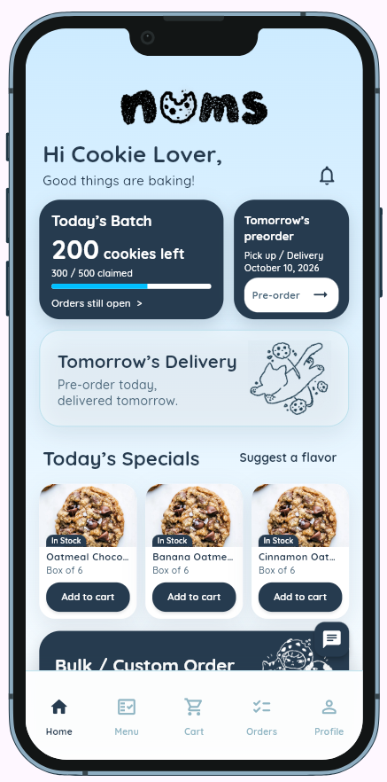
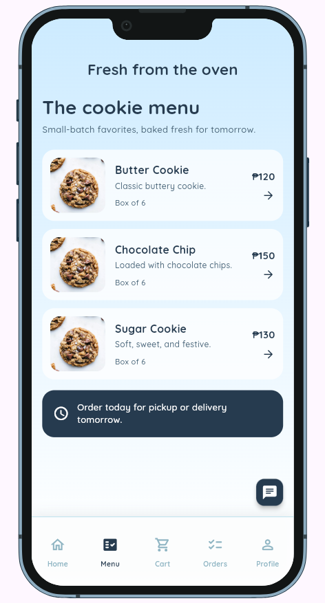
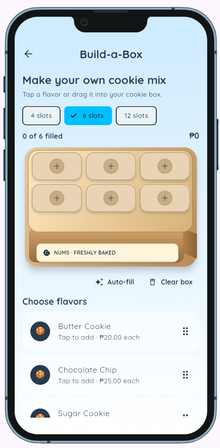
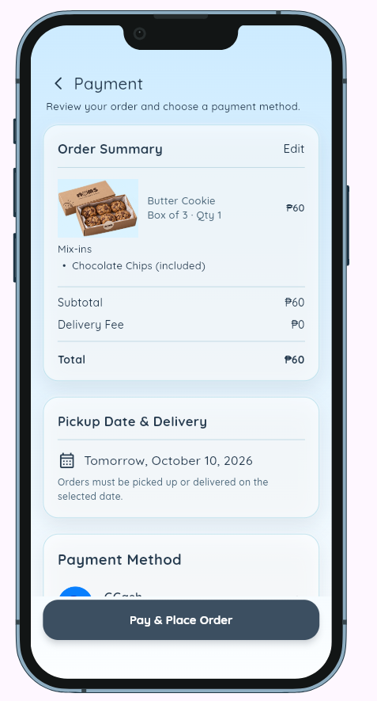
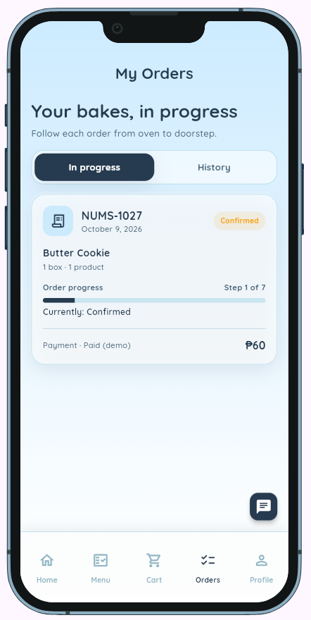

[](AI-USAGE.md)

# NUMS — Cookie Ordering App

A Flutter ordering app for a small home-based cookie bakery. Customers can browse and customize orders, while bakery staff can manage orders, inventory, and baking batches.

## Project Repository

- **GitHub Repository:** [JethroMarkBejec/nums](https://github.com/JethroMarkBejec/nums)
- **Live App:** [Open the deployed NUMS app](https://jethromarkbejec.github.io/nums/)

## Overview

NUMS brings cookie browsing, custom box building, checkout, and order tracking into one mobile-friendly app. It is intended for cookie customers and bakery staff; its accounts, state, and payment flow are local demonstrations that reset when the app restarts.

## Setup and Installation

### Prerequisites

- Flutter **3.47.5** (stable; version used for this project)
- Dart **3.13.4** (bundled with Flutter)
- Minimum supported versions in `pubspec.yaml`: Flutter **3.44.0** and Dart **3.12.0**
- Git
- Google Chrome for the web run command below, or a configured Flutter device/emulator
- Visual Studio Code is optional

### Installation

1. Clone the repository:

   ```bash
   git clone https://github.com/JethroMarkBejec/nums.git
   ```

2. Navigate to the project directory:

   ```bash
   cd nums
   ```

3. Install the dependencies:

   ```bash
   flutter pub get
   ```

4. No API keys, Firebase configuration, backend URL, or environment variables are required. The app uses local demo data. Do not reuse its demo passwords for real accounts.

## How to Run the App

Run the web app in Chrome:

```bash
flutter run -d chrome
```

Flutter opens the NUMS welcome screen. DevicePreview provides the mobile device preview in web builds and during development. The project keeps DevicePreview in its 1.x line to retain the embedded toolbar; version 3.x moves its controls to Flutter DevTools. To use another configured device, check the available targets with `flutter devices` and replace `chrome` with its device ID.

## Features and Usage

### Main Features

- **Customer ordering:** Browse cookie flavors, create a cookie box, customize an order, and manage cart quantities.
- **Checkout and order tracking:** Review an order, choose a payment method, confirm the local payment simulation, and follow its progress.
- **Notifications and profile:** Review order updates, manage customer preferences, and view the active demo account.
- **Chip assistant:** Use the local, rule-based assistant for ordering prompts and in-app navigation. Chip does not use a cloud AI service.
- **Bakery staff tools:** Review customer orders and requests, update order progress, adjust inventory, and manage baking batches.
- **Responsive preview:** Use DevicePreview during development to inspect the mobile layout at different device sizes.

### User Flow

#### Customer

1. **Welcome / Sign in / Sign up:** Start at Welcome and sign in or create a local demo account. Customer demo: `welcome@nums.com` / `cookies123`.
2. **Home / Menu:** View bakery updates and specials, then browse the cookie menu. The Home notification button opens order notifications.
3. **Build-a-Box / Customize:** Choose a box size, add flavors, and set optional customization details.
4. **Cart:** Review selected products and quantities before checkout.
5. **Payment:** Review the order total and pickup/delivery details, select GCash, Maya, or GoTyme, then confirm the demo payment. No money is charged or transferred.
6. **Confirmation / Orders / History:** View the order confirmation and track its status. Delivered orders can be reviewed in History.
7. **Profile / Chip:** View account preferences or open Chip for local guided help and navigation.

#### Bakery staff

Sign in with the local staff demo account `staff@nums.com` / `staff123`. Use the staff dashboard to open the order queue, inspect an order, progress its status, review customer requests, update stock, or manage bake batches. These demo credentials and staff checks are part of the client app and are not production security.

## Project Structure

```text
nums/
├── README.md
├── AI-USAGE.md
├── SECURITY-CHECKLIST.md
├── screenshots/                # Original screen captures supplied for the README
├── presentation/               # Presentation PDF and the square logo image
├── assets/                     # App images, payment marks, and fonts
├── lib/
│   ├── main.dart, app.dart      # App entry point, providers, theme, DevicePreview
│   ├── routes/                  # Named app routes and staff route gate
│   ├── screens/
│   │   ├── auth/                # Welcome, sign-in, sign-up, verification
│   │   ├── customer/            # Customer tabs, ordering, profile, notifications
│   │   └── admin/               # Staff dashboard, order, inventory, and batch screens
│   ├── models/                  # User, cookie, order, payment, and other data types
│   ├── providers/               # In-memory app state
│   ├── repositories/            # Local payment and points rules
│   ├── services/                # Local demo service implementations
│   ├── theme/, widgets/, utils/ # Shared styling, widgets, and helpers
├── web/                         # Web entry point, manifest, icons, and favicon
├── .github/workflows/           # GitHub Pages web deployment workflow
├── pubspec.yaml                 # Package constraints and Flutter assets
└── pubspec.lock                 # Resolved dependency versions
```

## Screenshots

These are the original captures currently supplied for the README, using their screen names:

### Home



*Customer home with bakery updates, specials, notifications, and navigation.*

### Menu



*Cookie menu with product descriptions, box sizes, and prices.*

### Build-a-Box



*Choose a box size and fill it with selected cookie flavors.*

### Payment



*Review an order and select a payment method for the local simulation.*

### Orders



*Track an order's current status and progress.*

The screenshots supplied so far do not cover every route. Add original captures for the remaining customer, authentication, Chip, and staff screens to meet the requirement of one screenshot per screen. The images here were supplied by the project author; no screenshots were captured or generated for this README.

## Known Issues and Limitations

- The app is intentionally a local demo. Accounts, cart contents, orders, notifications, inventory, and batch progress are stored in memory and reset when the app restarts.
- Sign-in and staff role checks run in the client app; they are not secure authentication or server-side authorization.
- GCash, Maya, and GoTyme are payment choices in a local simulation. The app does not charge or transfer money.
- Daily batch counts and some bakery content use sample values.
- Chip uses local rules and preset actions; it does not connect to a remote AI service.

### Next Steps

- Capture and add the remaining screens from the running app.
- If the app is later used beyond a classroom demo, consider persistent shared data, secure authentication and authorization, and a real payment-provider integration.
- Replace sample bakery values with managed live values if needed.

## Presentation

- **Presentation Video:** [Watch the public Google Drive video](https://drive.google.com/file/d/15gs5qLaw--Mx22JCGuuMSLaYZf6bw_C7/view?usp=sharing)
- **Presentation Slides:** [Download the updated PDF](presentation/NUMS-Presentation.pdf)
- **Square Image:** [NUMS logo](presentation/nums_logo.png)

## AI Usage Disclosure

AI credit: I used Claude and OpenAI Codex extensively during the initial implementation (September 20–October 4), then used OpenAI Codex for Flutter/Dart revisions on October 5 and 9 and compatibility maintenance on October 11. My retrospective 80% AI / 20% personal-contribution estimate applies to the initial implementation only; it is not a line-by-line measurement. My contributions included writing the initial welcome, login, and sign-up screens; setting the visual direction; reviewing spacing and motion; and guiding feature scope, including keeping relevant points rewards while removing the standalone game. See [`AI-USAGE.md`](AI-USAGE.md) for the code-focused usage record and a clear distinction between my design decisions and code authorship.

## Security

Security considerations and checklist responses are documented in [`SECURITY-CHECKLIST.md`](SECURITY-CHECKLIST.md).
